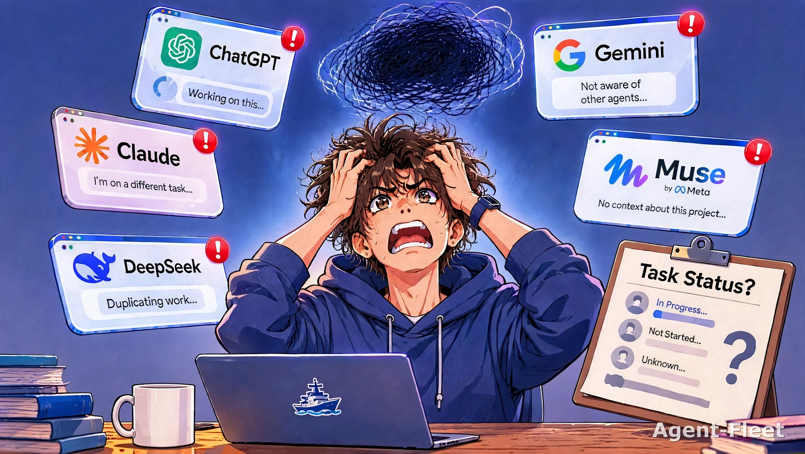

# AI-Fleet-Open-Source-Version

AI Fleet cross-vendor agent collaboration platform — open-source, self-hostable. A2A + MCP.

## The Problem

Different AI agents work in isolation: they do not know what the others are doing, they duplicate work, and they have no shared context — leaving one person to carry the confusion. AI Fleet connects them.
